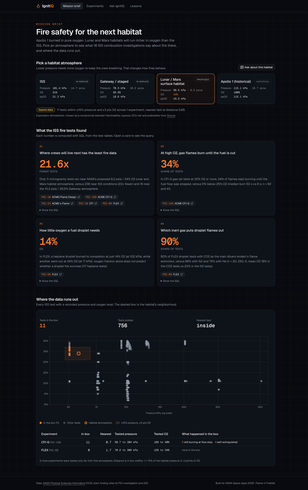

<div align="center">

# IgnitIQ

**Fire safety for the next space habitat.** IgnitIQ turns 18 ISS combustion experiments into answers: pick a habitat atmosphere, ask a fire safety question, and get an answer computed from real test rows and cited to the NASA investigation behind it.


**Live demo:** [ignit-iq.vercel.app](https://ignit-iq.vercel.app) | **Demo video:** [youtu.be/Jy1ILpy2_Aw](https://youtu.be/Jy1ILpy2_Aw) | **API:** [ignit-iq.onrender.com/docs](https://ignit-iq.onrender.com/docs)

<sub>The API sleeps when idle, so the first load can take up to a minute while it wakes.</sub>

</div>

The database is the source of truth and the model is the interface. Numbers come from SQL over the ISS test tables, explanations come from the investigation write-ups, and every answer is checked before it is shown: each number must trace to a query result and to the investigation its sentence cites. Built solo for the NASA Space Apps Challenge 2026, challenge **Flame in Freefall**.



## Why

Apollo 1 burned in pure oxygen. The habitats NASA is designing for the Moon and Mars will run at lower pressure and higher oxygen than the ISS (8.2 psia and 34% O2), which changes how fires start and spread. Fifteen years of microgravity combustion experiments on the ISS hold real evidence about that, spread across dozens of investigations and data tables. IgnitIQ puts that evidence in one place and shows exactly where it runs out.

## What it does

- **Mission brief:** pick ISS, Gateway, the lunar/Mars surface habitat, or Apollo 1 as a historical reference. See ranked findings for that atmosphere and a coverage chart of every tested pressure and oxygen level, with the habitat marked. Near the lunar/Mars atmosphere there are 21.6x fewer tests than near ISS conditions.
- **Experiment explorer:** filter all 1,953 test rows by experiment, outcome, fuel, pressure and oxygen, and open any investigation with its DOI.
- **Ask IgnitIQ:** a chat that shows its work. Every answer lists the SQL it ran, the passages it read, and a check of every number in it.
- **Lessons:** Apollo 1, Apollo 13 and the 1997 Mir fire, each linked to the findings that apply and to what the data cannot tell us.

## How it works

```
PSI investigation API      OpenAlex             NASA incident pages
(metadata, CSVs, DOIs)     (abstracts)          (Apollo 1, 13, Mir, 2015 guide)
          \                    |                    /
           +------ Ingest and normalize ----------+
                (httpx, pandas, pydantic, units to kPa)
                 /                          \
           DuckDB                       Embedding index
 (1,999 test rows, 23 investigations,  (316 chunks, bge-small,
  350 publications, insights)           NumPy cosine search)
       |        \ SQL                 passages /
       |         +---- Agent in FastAPI ------+
       |          4 tools: query_tests, search_docs,
       |          get_investigation, nearest_conditions
       | /insights, /tests, /coverage    | /ask (streamed over SSE)
       +-------- Next.js app on Vercel --------+
```

**Numbers come from SQL, never from the model.** The agent answers with four tools: read-only SQL over the test tables, semantic search over investigation text, investigation lookup, and a nearest-tested-conditions search for a habitat atmosphere. The SQL tool is locked down in four layers: one SELECT only, a read-only connection, no file or network access, and a 200-row cap with a 10 s timeout.

**Every answer is checked before it is shown.** Each number in the answer must trace to a tool result, and to the investigation its sentence cites. Each citation must point to something a tool actually returned. If a number fails, the agent gets one rewrite with the exact failures listed, and the rewrite is kept only if it checks out better. Anything still unverified is flagged in the UI.

**$0 to run.** Open models through free tiers: `gpt-oss-120b` on Groq, falling back to Qwen on Groq and to Nemotron and Gemma on OpenRouter.

| Layer | Choice |
| --- | --- |
| Data | DuckDB, pandas, pydantic |
| Retrieval | fastembed `BAAI/bge-small-en-v1.5` (ONNX), NumPy cosine top-k |
| Agent | hand-written tool loop, OpenAI-compatible client, no framework |
| API | FastAPI, SSE streaming, Docker on Render |
| Frontend | Next.js 15, TypeScript, Tailwind, shadcn/ui, Recharts, on Vercel |

## Evaluation

[`backend/eval/`](backend/eval) holds 15 questions run against the live API: counts, shares, ranges, habitat coverage, text questions, an out-of-scope question and a data gap. The expected numbers are computed from the database at run time, not typed in. Each answer is scored separately on numbers, verified citations, facts (including phrases it must not say), the SQL it used, and grounding.

**Result: 15 of 15 pass on the latest live run of each question** (median 1.6 s per answer). The first full run passed 7 of 15. The eval found a model computing a share in its head, a minimum taken across two different tests, a number invented for an empty query result, and a misread outcome. Each was fixed in the tools and the answer check (result notes, a rewrite round, outcomes in plain words), plus one rule in the SQL tool's description. Details: [`backend/eval/results.md`](backend/eval/results.md).

## Run it locally

Backend (Python 3.11, [uv](https://docs.astral.sh/uv/)):

```bash
cd backend
uv sync
cp .env.example .env          # add GROQ_API_KEY and OPENROUTER_API_KEY
uv run uvicorn api.main:app --reload --port 8000
```

The processed database and index are committed, so no ingestion is needed. To rebuild from the source data:

```bash
uv run python ingest/psi.py all
uv run python ingest/abstracts.py
uv run python ingest/context.py
uv run python -m ignitiq.db
uv run python -m ignitiq.rag index
```

Frontend (Node 22):

```bash
cd web
npm install
echo "NEXT_PUBLIC_API_URL=http://localhost:8000" > .env.local
npm run dev
```

Checks and eval, from `backend/`:

```bash
uv run python -m ignitiq.tools               # tool and SQL-guard self-test
uv run python -m api.smoke                   # API contract
uv run python -m eval.run_eval --truth       # print the eval answer key, no API calls
uv run python -m eval.run_eval               # run the eval against the live API
```

Deploy: `render.yaml` defines the API service (Docker, `backend/`). The Vercel project uses `web/` as its root, with `NEXT_PUBLIC_API_URL` set to the API URL.

## Known limitations

- The answer check verifies numbers, not meaning. On the lunar coverage question, the model sometimes misstates what "flow terminated" means (the flame was still burning when the fuel was cut). The Mission brief shows those outcomes straight from SQL.
- A small round number can match a tool result by coincidence, so the number check can miss a wrong citation on it.
- Some PSI tables are test logs rather than measurements (BASS records dates and samples; its results are in its publications).
- No test comes near Apollo 1's pure oxygen cabin: the highest ambient oxygen tested is 40%.

## Data and credits

All data comes from the NASA Physical Sciences Informatics (PSI) system, released under CC0: investigation metadata, experimental tables and publication lists, plus publication abstracts from OpenAlex and NASA's pages on Apollo 1, Apollo 13 and the 1997 Mir fire. Raw video and image files are not used.

PSI asks users to cite each investigation's DOI:

| PSI id | Acronym | Title | DOI |
| --- | --- | --- | --- |
| PSI-10 | ACME/Flame Design | Advanced Combustion via Microgravity Experiments / Flame Design | [10.60555/w4zy-bt45](https://doi.org/10.60555/w4zy-bt45) |
| PSI-20 | ACME BRE | Advanced Combustion via Microgravity Experiments - Burning Rate Emulator | [10.60555/vb93-3y72](https://doi.org/10.60555/vb93-3y72) |
| PSI-21 | ACME CLD Flame | Advanced Combustion via Microgravity Experiments / Coflow Laminar Diffusion Flame | [10.60555/23e1-9950](https://doi.org/10.60555/23e1-9950) |
| PSI-22 | ACME E-FIELD Flames | Advanced Combustion via Microgravity Experiments Electric-Field Effects on Laminar Diffusion Flames | [10.60555/se5a-8c73](https://doi.org/10.60555/se5a-8c73) |
| PSI-23 | ACME s-Flame | Advanced Combustion via Microgravity Experiments-Structure and Response of Spherical Diffusion Flames | [10.60555/k57n-p030](https://doi.org/10.60555/k57n-p030) |
| PSI-25 | BASS-II | Burning and Suppression of Solids - II | [10.60555/4qc4-de67](https://doi.org/10.60555/4qc4-de67) |
| PSI-26 | BASS | Burning and Suppression of Solids | [10.60555/58h4-dy80](https://doi.org/10.60555/58h4-dy80) |
| PSI-39 | CFI | Cool Flames Investigation | [10.60555/m6pj-a914](https://doi.org/10.60555/m6pj-a914) |
| PSI-60 | - | Computational and Experimental Analysis of SPICE Data Sets | [10.60555/mzjm-yv57](https://doi.org/10.60555/mzjm-yv57) |
| PSI-62 | - | Concurrent Flame Spread Modeling using Flamelet Generated Manifolds in Microgravity with Comparison to BASS Experiments using Two-Color Tomography | [10.60555/e9xp-ex83](https://doi.org/10.60555/e9xp-ex83) |
| PSI-68 | FLEX-2 | Flame Extinguishment Experiment - 2 | [10.60555/byp8-h018](https://doi.org/10.60555/byp8-h018) |
| PSI-69 | FLEX | Flame Extinguishment Experiment | [10.60555/mbq8-0451](https://doi.org/10.60555/mbq8-0451) |
| PSI-98 | SAFFIRE-I | Spacecraft Fire Safety Experiment-I | [10.60555/0t15-1z43](https://doi.org/10.60555/0t15-1z43) |
| PSI-99 | SAFFIRE-II | Spacecraft Fire Experiment-II | [10.60555/2chp-m469](https://doi.org/10.60555/2chp-m469) |
| PSI-100 | SAFFIRE-III | Spacecraft Fire Experiment-III | [10.60555/040q-4h36](https://doi.org/10.60555/040q-4h36) |
| PSI-101 | SAME-R | Smoke Aerosol Measurement Experiment-Reflight | [10.60555/2np7-jv14](https://doi.org/10.60555/2np7-jv14) |
| PSI-102 | SAME | Smoke and Aerosol Measurement Experiment | [10.60555/gd4k-8h62](https://doi.org/10.60555/gd4k-8h62) |
| PSI-106 | SLICE | Structure and Liftoff In Combustion Experiment | [10.60555/pm12-rg61](https://doi.org/10.60555/pm12-rg61) |
| PSI-107 | SPICE | Smoke Point In Co-flow Experiment | [10.60555/9kbh-e962](https://doi.org/10.60555/9kbh-e962) |
| PSI-115 | - | Utilization of the Smoke Aerosol Measurement Experiment Data for Advanced Modeling and Simulation of Smoke Generation in Micro-Gravity | [10.60555/q0v5-1v28](https://doi.org/10.60555/q0v5-1v28) |
| PSI-117 | - | Effect of External Thermo-Convective Perturbation on Cool Flame Dynamics: A Multidimensional Multi-Physics CFD Analysis | [10.60555/gz0q-b577](https://doi.org/10.60555/gz0q-b577) |
| PSI-142 | - | Quantitative Studies of Cool Flame Transitions at Radiation / Stretch Extinction Using Counterflow Flames | [10.60555/80qf-vj95](https://doi.org/10.60555/80qf-vj95) |
| PSI-159 | ACME CFI-G | Advanced Combustion via Microgravity Experiments / Cool Flames Investigation with Gases | [10.60555/cyt1-kh64](https://doi.org/10.60555/cyt1-kh64) |

## AI use

Built with help from Claude (Anthropic) for planning, code review and writing. Every line of code was run and checked by the author. The app itself uses open models (see above).